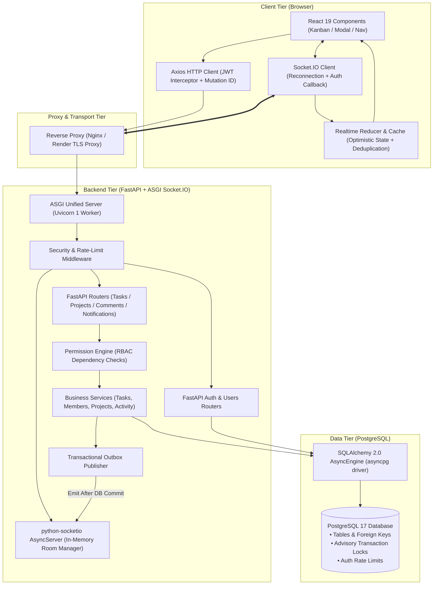
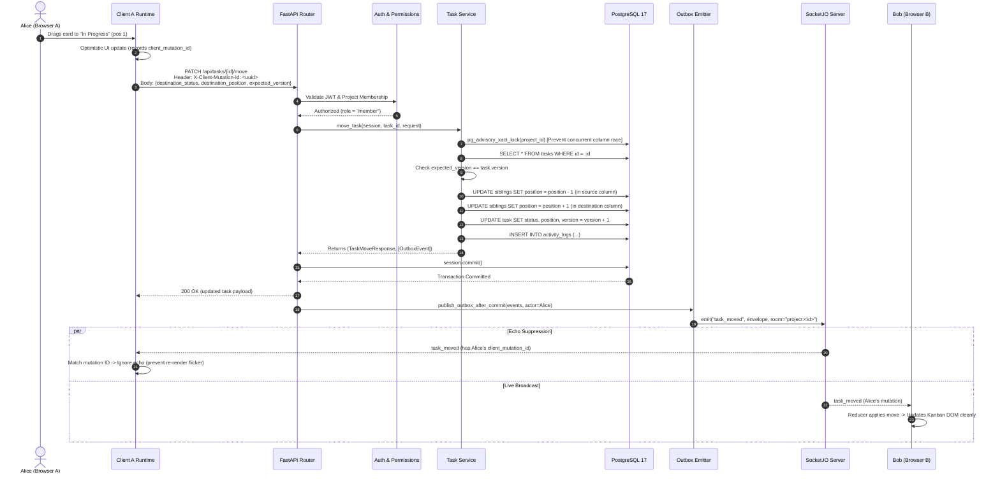

# TaskFlow — System Architecture & Data Flow

This document details the software architecture, synchronization mechanics, concurrency controls, and real-time transaction flows powering TaskFlow.

---

## 1. System Architecture Diagram



---

## 2. Core Architectural Principle: Emit-After-Commit

A critical design requirement in real-time collaborative applications is **preventing phantom events**. If a server broadcasts a WebSocket event before the database transaction commits, and that transaction subsequently rolls back (e.g., due to a constraint violation or network blip), clients will display state that never existed in the database.

TaskFlow solves this with an **in-memory transactional outbox pattern**:
1. Service methods (`create_task`, `update_task`, `move_task`, `delete_task`, `add_comment`) accept an open `AsyncSession`.
2. All database mutations (task changes, affected sibling reorders, activity log rows, and notification rows) are made within the same transaction.
3. The service compiles a list of `OutboxEvent` descriptors in memory and returns them alongside the domain model.
4. The router explicitly commits the session: `await session.commit()`.
5. Only **after** `session.commit()` completes without error does the router call:
   ```python
   await publish_outbox_after_commit(outbox, actor=user)
   ```
6. If the database transaction fails or rolls back, the outbox list is discarded and no Socket.IO events are emitted.

---

## 3. Sequence Diagram: "Member Moves a Task"

The following sequence illustrates a project member dragging a task to a new status/position:



---

## 4. Concurrency Control & 409 Conflict Resolution

TaskFlow prevents lost updates and race conditions across concurrent browser sessions using **Optimistic Concurrency Control (OCC)** coupled with **PostgreSQL Transaction Advisory Locking**.

### OCC Flow
1. Every task entity maintains an integer `version` field (starts at `1`).
2. When a client issues `PATCH /api/tasks/{id}`, it must submit `expected_version`:
   ```json
   {
     "title": "Updated Title",
     "expected_version": 2
   }
   ```
3. If another user modified the task in the meantime, `task.version` in the database is now `3`.
4. The service detects `task.version != request.expected_version` and raises `TaskVersionConflict`:
   ```json
   HTTP 409 Conflict
   {
     "detail": "Task was modified by another user.",
     "code": "version_conflict",
     "current": {
       "id": "b65288ef-...",
       "version": 3,
       "title": "Concurrent edit by other member",
       "updated_at": "2026-11-18T17:18:22Z"
     }
   }
   ```
5. The frontend displays a conflict notification toast, incorporates the latest server values, and prevents silently overwriting teammate contributions.

### Column Reordering Advisory Locks
When moving tasks between or within columns, sibling positions must be rewritten contiguously. To prevent two simultaneous moves in the same project from interleaving and creating duplicate positions or gaps, `move_task` acquires a session-scoped PostgreSQL transaction advisory lock:
```sql
SELECT pg_advisory_xact_lock(hashtext(:project_id));
```
This guarantees strictly serialized task repositioning per project while executing concurrently across different projects.

---

## 5. Member-Removal & Revocation Flow

When a project owner or admin removes a collaborator:
1. `DELETE /api/projects/{id}/members/{user_id}` runs inside an atomic transaction.
2. The member row is removed from `project_members`.
3. Any open task assignments or reviewer assignments for that user in that project are automatically cleared (`assigned_to = NULL`, `reviewer_id = NULL`) and recorded in the audit log.
4. Transaction commits.
5. Two Socket.IO events are emitted:
   - `member_changed` (action: `removed`) broadcasted to `project:{project_id}` so remaining collaborators immediately see the updated members roster.
   - `removed_from_project` emitted directly to the removed user's private channel `user:{user_id}`.
6. The server automatically evicts all active sockets belonging to that user from `project:{project_id}`.
7. Any subsequent socket requests from that user attempting `join_project` are checked against `project_members` and rejected with `{"ok": false, "error": "forbidden"}`.

---

## 6. Reconnection & Resynchronization Flow

If a client temporarily loses internet connectivity:
1. The Socket.IO client automatically attempts reconnection with exponential backoff.
2. The UI connection indicator switches to **Reconnecting** (amber).
3. Upon reconnection, the client re-emits `join_project` for the currently viewed project with its JWT.
4. Once room membership is re-confirmed by the server, `useProjectRealtime` triggers a background `refetch()` of the active project tasks.
5. The local React state reconciles any missed events that occurred during the disconnected window without full-page reloads or layout jumps.
