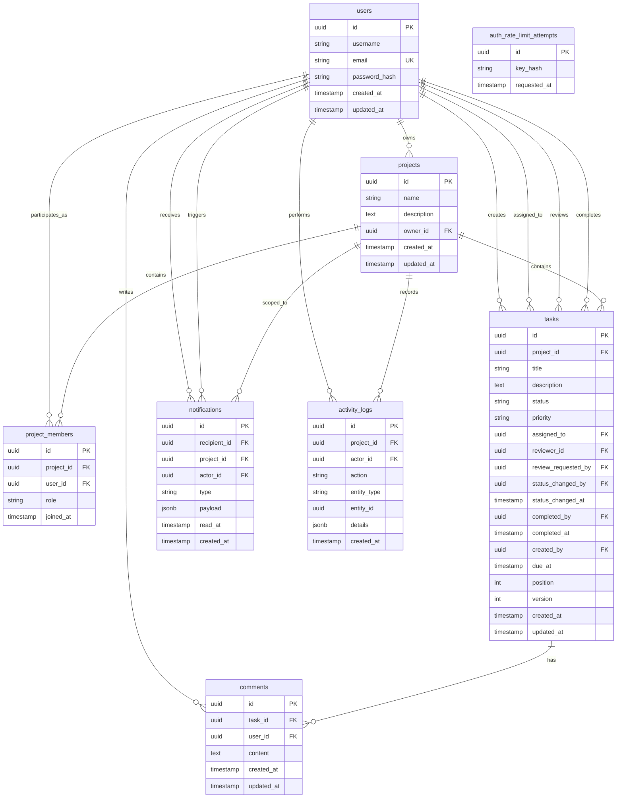

# TaskFlow — Entity-Relationship (ER) Diagram & Database Schema

This document provides the definitive data model reference for TaskFlow, derived directly from the SQLAlchemy 2.0 async models in `backend/app/models/` and Alembic migrations in `backend/alembic/versions/`.

---

## 1. Entity-Relationship Diagram

---

## 2. Table Specifications & Delete Behaviours

### A. `users`
Represents registered user accounts.
- **Primary Key:** `id` (UUIDv4)
- **Delete Behaviour:** Users cannot be deleted directly if they own projects, created tasks, authored comments, or performed logged activity (`RESTRICT` foreign key rules).

### B. `projects`
Workspaces containing members and tasks.
- **Foreign Keys:**
  - `owner_id` $\rightarrow$ `users.id` (`ON DELETE RESTRICT`)
- **Delete Behaviour:** When a project is deleted by its owner:
  - All `project_members` are deleted (`CASCADE`).
  - All `tasks` (and nested `comments`) are deleted (`CASCADE`).
  - All `activity_logs` for the project are deleted (`CASCADE`).
  - All `notifications` for the project are deleted (`CASCADE`).

### C. `project_members`
Association table linking users to projects with scoped roles (`owner`, `admin`, `member`).
- **Foreign Keys:**
  - `project_id` $\rightarrow$ `projects.id` (`ON DELETE CASCADE`)
  - `user_id` $\rightarrow$ `users.id` (`ON DELETE RESTRICT`)
- **Delete Behaviour:** When a member is removed from a project:
  - Association row is deleted.
  - Active task assignments (`assigned_to`) and reviewer assignments (`reviewer_id`) for that user within the project are automatically cleared (`SET NULL`) via transactional service logic.

### D. `tasks`
Kanban work items scoped to a project.
- **Foreign Keys:**
  - `project_id` $\rightarrow$ `projects.id` (`ON DELETE CASCADE`)
  - `created_by` $\rightarrow$ `users.id` (`ON DELETE RESTRICT`)
  - `assigned_to` $\rightarrow$ `users.id` (`ON DELETE SET NULL`)
  - `reviewer_id` $\rightarrow$ `users.id` (`ON DELETE SET NULL`)
  - `review_requested_by` $\rightarrow$ `users.id` (`ON DELETE SET NULL`)
  - `status_changed_by` $\rightarrow$ `users.id` (`ON DELETE SET NULL`)
  - `completed_by` $\rightarrow$ `users.id` (`ON DELETE SET NULL`)
- **Delete Behaviour:** When a task is deleted:
  - All associated `comments` are deleted (`CASCADE`).

### E. `comments`
Discussion messages posted under specific tasks.
- **Foreign Keys:**
  - `task_id` $\rightarrow$ `tasks.id` (`ON DELETE CASCADE`)
  - `user_id` $\rightarrow$ `users.id` (`ON DELETE RESTRICT`)

### F. `notifications`
User-scoped alerts generated on task assignment, review requests, comments, or role changes.
- **Foreign Keys:**
  - `recipient_id` $\rightarrow$ `users.id` (`ON DELETE CASCADE`)
  - `project_id` $\rightarrow$ `projects.id` (`ON DELETE CASCADE`)
  - `actor_id` $\rightarrow$ `users.id` (`ON DELETE SET NULL`)

### G. `activity_logs`
Audit trails tracking project, task, and member actions.
- **Foreign Keys:**
  - `project_id` $\rightarrow$ `projects.id` (`ON DELETE CASCADE`)
  - `actor_id` $\rightarrow$ `users.id` (`ON DELETE RESTRICT`)

### H. `auth_rate_limit_attempts`
PostgreSQL-backed sliding window rate-limiting attempts shared across application workers.
- Standalone table; stores SHA-256 key hash of `(action, ip, email)` and request timestamp.

---

## 3. Constraints & Indexes Matrix

| Table | Constraint / Index Name | Type | Target Columns / Expression | Purpose |
| :--- | :--- | :---: | :--- | :--- |
| `users` | `pk_users` | Primary Key | `id` | Unique row identifier |
| `users` | `uq_users_email` | Unique | `email` | Prevent duplicate user registration |
| `users` | `ck_users_email_normalized` | Check | `email = LOWER(email)` | Enforce normalized lower-case emails at database level |
| `projects` | `pk_projects` | Primary Key | `id` | Unique row identifier |
| `projects` | `ix_projects_owner_id` | Index | `owner_id` | Accelerate listing projects owned by a user |
| `project_members` | `pk_project_members` | Primary Key | `id` | Unique row identifier |
| `project_members` | `uq_project_members_project_user` | Unique | `(project_id, user_id)` | Prevent duplicate membership in same project |
| `project_members` | `uq_project_members_one_owner_per_project` | Unique Partial Index | `project_id` WHERE `role = 'owner'` | Ensure strict invariant of exactly one owner per project |
| `project_members` | `ck_project_members_project_role` | Check | `role IN ('owner', 'admin', 'member')` | Ensure valid enum value storage |
| `project_members` | `ix_project_members_user_id` | Index | `user_id` | Accelerate fetching all projects a user belongs to |
| `tasks` | `pk_tasks` | Primary Key | `id` | Unique row identifier |
| `tasks` | `ix_tasks_project_status_position` | Composite Index | `(project_id, status, position)` | Optimal lookup and sort for Kanban column rendering |
| `tasks` | `ix_tasks_assigned_to` | Index | `assigned_to` | Fast filter for "My Tasks" and assignee queries |
| `tasks` | `ix_tasks_reviewer_id` | Index | `reviewer_id` | Fast lookup for assigned reviewer workflows |
| `tasks` | `ix_tasks_completed_by` | Index | `completed_by` | Fast lookup for completion audit reports |
| `tasks` | `ix_tasks_due_at` | Index | `due_at` | Fast overdue and due-date ordering and filtering |
| `tasks` | `ck_tasks_version_positive` | Check | `version >= 1` | Ensure optimistic lock version integer is always $\ge 1$ |
| `tasks` | `ck_tasks_position_nonnegative` | Check | `position >= 0` | Ensure Kanban column ordering index is non-negative |
| `tasks` | `ck_tasks_task_status` | Check | `status IN ('todo', 'in_progress', 'review', 'completed')` | Valid status validation |
| `tasks` | `ck_tasks_task_priority` | Check | `priority IN ('low', 'medium', 'high', 'urgent')` | Valid priority validation |
| `comments` | `pk_comments` | Primary Key | `id` | Unique row identifier |
| `comments` | `ix_comments_task_created_at` | Composite Index | `(task_id, created_at)` | Fast timeline retrieval of task comments |
| `notifications` | `pk_notifications` | Primary Key | `id` | Unique row identifier |
| `notifications` | `ix_notifications_recipient_read_created` | Composite Index | `(recipient_id, read_at, created_at)` | Fast unread-counter and notification tray queries |
| `activity_logs` | `pk_activity_logs` | Primary Key | `id` | Unique row identifier |
| `activity_logs` | `ix_activity_logs_project_created_at` | Composite Index | `(project_id, created_at)` | Fast project activity feed queries |
| `auth_rate_limit_attempts` | `pk_auth_rate_limit_attempts` | Primary Key | `id` | Unique row identifier |
| `auth_rate_limit_attempts` | `ix_auth_rate_limit_attempts_key_requested` | Composite Index | `(key_hash, requested_at)` | Sliding-window attempt count queries |
| `auth_rate_limit_attempts` | `ix_auth_rate_limit_attempts_requested_at` | Index | `requested_at` | Efficient background pruning of expired attempts |
